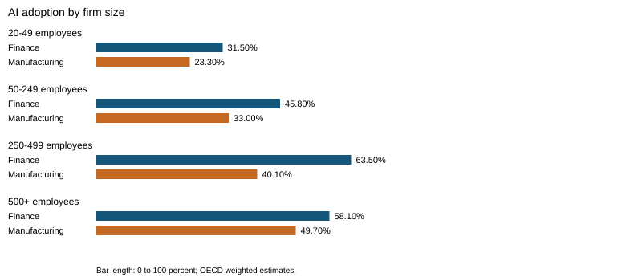
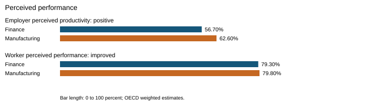
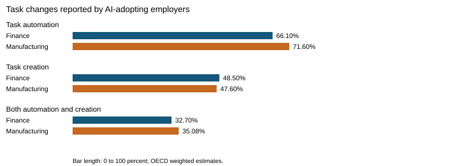
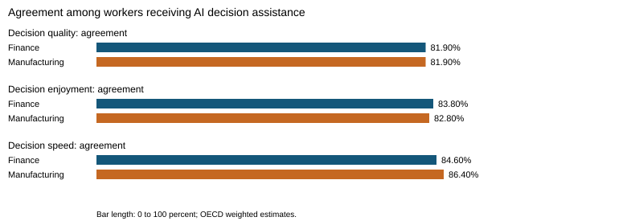

# Workplace AI Adoption, Perceived Performance and Implementation Barriers
## A Comparative Secondary Analysis of OECD Employer and Worker Surveys

MBA research project | Primary domain: Operations Management | Methodology: descriptive secondary-data analysis

Evidence: OECD survey fieldwork in 2022, report and supplementary tables published in 2023. This package contains completed descriptive analysis of published aggregates. It does not claim institutional approval, primary questionnaire collection, or a Chennai sample.

## Abstract

This project examines artificial intelligence adoption and perceived workplace performance using published OECD employer and worker survey tables. It considers adoption, productivity perceptions, task changes, decision assistance, and implementation barriers in finance and insurance and manufacturing across seven OECD countries. The method extracts weighted proportions from specified spreadsheet cells, checks response distributions, computes percentages and percentage-point differences, and produces reproducible tables and figures. Employer AI adoption is 41.7% in finance and insurance and 29.0% in manufacturing. Among AI-adopting employers, 56.7% and 62.6%, respectively, report positive productivity effects. Among AI-using workers, 79.3% and 79.8% report improved own performance. Workers receiving decision assistance generally report better and faster decisions. These are reported perceptions and descriptive comparisons; they do not demonstrate causation or measured financial returns. A source inconsistency in a finance staff-cost motivation item is disclosed and excluded from comparison. Recommendations emphasize bounded pilots, worker training, human oversight, and measurement of actual operational outcomes. The completed secondary analysis cannot establish findings about Chennai IT/IT-enabled services.

## Chapter 1. Introduction and research scope

### 1.1 Operational problem

AI can change how organizations allocate work, automate tasks, and support decisions. Operations managers need to judge whether these changes improve output quality and timeliness, create new work, or introduce additional costs and risks. Adoption alone is insufficient evidence of success. This study examines what surveyed employers and workers report, while separating these perceptions from independently measured efficiency.

### 1.2 Scope and design change

The original project proposed a primary questionnaire among managers or team leads in Chennai IT/IT-enabled services. Genuine responses and reviewed recruitment arrangements were unavailable. This completed report therefore adopts an explicit secondary-data design, using the OECD sources supplied for this project. It changes the population and measurement framework; it does not retrofit OECD percentages into the Chennai questionnaire. The original primary-survey software remains a separate possible future study.

The source study covers Austria, Canada, France, Germany, Ireland, the United Kingdom, and the United States, in finance and insurance and manufacturing. Employer firms have at least 20 employees. The source reports 2,053 firms and 5,334 workers overall. The present analysis selects published estimates, not individual records. Employer and worker observations are different populations and are not paired.

### 1.3 Objectives and research questions

O1 / RQ1: Describe how published AI adoption estimates differ by sector and firm size.

O2 / RQ2: Describe employers' productivity perceptions and workers' own performance perceptions among the relevant AI-adopting/using subgroups.

O3 / RQ3: Describe reported task automation, task creation, pace, and control associated with workplace AI use.

O4 / RQ4: Describe the prevalence of decision assistance and perceived decision quality, enjoyment, and speed among workers receiving it.

O5 / RQ5: Describe published adoption barriers, particularly cost and skills, without interpreting them as realized cost savings.

These questions are descriptive. No causal hypothesis or respondent-level association is tested with the aggregate workbook.

## Chapter 2. Evidence and conceptual framework

### 2.1 Evidence base

Lane, Williams, and Broecke (2023) report employer and worker surveys about AI adoption, workplace effects, and attitudes. Their supplementary OECD workbook supplies the quantitative inputs used here. The original report contains the survey methodology, question wording, figures, and wider bibliography. This project relies on those two supplied sources rather than claiming a new comprehensive systematic literature review.

### 2.2 Operational framework

The framework connects AI adoption with reported productivity, changes to tasks, and decision support, with cost and skill constraints affecting implementation. This is a conceptual organizing framework, not an estimated causal model. Productivity, own performance, task pace, task control, and decision speed are distinct measures. They are not combined into an invented operational-efficiency score. Employer perceptions and worker perceptions are presented separately.

Realized cost optimization would require actual expense, output, and rework measurements with an appropriate comparison. The workbook's cost-barrier and motivation items do not supply those measurements. Faster task pace can also indicate work intensification and should not automatically be treated as a benefit.

## Chapter 3. Methodology

### 3.1 Research design, population, and unit

This is a quantitative descriptive secondary analysis of published cross-sectional survey aggregates. The original OECD researchers performed recruitment and weighting. This project did not recruit participants, administer a questionnaire, or determine the original sample. The analytical unit is a published sector or firm-size estimate with its documented source question and subgroup, rather than a new individual respondent.

### 3.2 Inclusion and exclusion

Included estimates have a numeric proportion in [0,1], identifiable sector and response category, clear figure provenance, and a relevant operational research question. Selected sources are Figures 2.1, 3.2, 3.3, 5.1, 5.6, 5.8, 5.9, and 8.7. Figure 3.1 is inspected for a cost-item quality check. Detailed application subcategories and other unselected figures are outside this analysis.

The finance staff-cost motivation distribution in Figure 3.1 sums to 94%, despite its displayed total of 100%. It is retained in the audit data but excluded from comparative findings. Values are not normalized and the unexplained remainder is not assigned to an answer category. Source files remain unchanged.

### 3.3 Denominators and measurement

AI adoption and barriers use all surveyed employers: finance n=653 and manufacturing n=1,400. Employer productivity and task changes refer to AI-adopting employers: n=291 and n=452. Worker performance, pace, control, and decision-assistance prevalence refer to AI-using workers: finance n=1,231 and manufacturing n=912. Decision-quality, enjoyment, and speed agreement refer to assisted workers: n=883 and n=558. These are source unweighted subgroup sizes, not reconstructed response counts. Percentages use the source's weighted estimates.

### 3.4 Extraction, cleaning, and analysis

The reproducible script reads the supplied workbook without editing it. Each extracted category records the sheet, cell, source proportion, transformed percentage, and subgroup size. Complete response distributions are checked against 100%, permitting a 0.2 percentage-point rounding tolerance. Multiple-response task indicators are kept separate because automation and task creation can overlap. 'Do not know' is retained; it is not converted into missing data or a negative answer.

Percentage = source proportion multiplied by 100. Improved worker performance sums 'improved a lot' and 'improved a little'. Decision agreement sums 'strongly agree' and 'somewhat agree'. Increased pace or control sums its two increase categories. A sector difference is manufacturing percentage minus finance percentage, expressed in percentage points. It is not a percentage change and is not a significance test.

No respondent imputation, duplicate deletion, new reliability coefficient, regression, correlation, p-value, or confidence interval is produced. Such analyses would require compatible individual data and survey-design information. File hashes identify the original inputs; validation diagnostics remain available separately from conclusions.

### 3.5 Ethics and reproducibility

The package uses published aggregate tables and contains no individual respondent records. It neither claims new participant consent nor invents ethics approval. Original OECD authorship and sources are acknowledged. Institutional acceptance of the secondary-data design and local formatting requirements must be confirmed externally. The report, extraction code, charts, and audit outputs can be rebuilt from the packaged source workbook. The same Python pipeline is callable from the included Databricks notebook; platform execution does not change the evidence or analysis. Live cloud execution requires an actual workspace and is not certified by local tests.

## Chapter 4. Results

### 4.1 AI adoption

Table 1. Published adoption estimates by firm size; source Figure 2.1. Sector totals are 41.70% finance and insurance and 29.00% manufacturing.

| Indicator | Finance (%) | Manufacturing (%) | Difference (pp) |
|---|---:|---:|---:|
| 20-49 employees | 31.50 | 23.30 | -8.20 |
| 50-249 employees | 45.80 | 33.00 | -12.80 |
| 250-499 employees | 63.50 | 40.10 | -23.40 |
| 500+ employees | 58.10 | 49.70 | -8.40 |

Adoption is higher in finance in every displayed size band. The manufacturing estimate increases across the size bands. Finance does not increase monotonically: its 500+ employee estimate is lower than its 250-499 estimate. These patterns are descriptive and do not establish that firm size causes adoption.

### 4.2 Perceived performance and productivity

Table 2. Positive employer productivity and improved worker performance; Figures 3.2 and 3.3. The populations differ and must not be averaged into one metric.

| Indicator | Finance (%) | Manufacturing (%) | Difference (pp) |
|---|---:|---:|---:|
| Employer perceived productivity: positive | 56.70 | 62.60 | +5.90 |
| Worker perceived performance: improved | 79.30 | 79.80 | +0.50 |

Among AI-adopting employers, manufacturing's positive productivity estimate exceeds finance by 5.90 percentage points. Worker improvement estimates are similar, differing by 0.50 points. These are perceptions reported in separate surveys; they are not measured productivity gains or proof of comparable benefits for all firms.

### 4.3 Task changes and work organization

Table 3. AI-adopting employers reporting task changes; Figure 5.1. Categories overlap.

| Indicator | Finance (%) | Manufacturing (%) | Difference (pp) |
|---|---:|---:|---:|
| Task automation | 66.10 | 71.60 | +5.50 |
| Task creation | 48.50 | 47.60 | -0.90 |
| Both automation and creation | 32.70 | 35.08 | +2.38 |

Automation and task creation coexist. 'Both' is an overlapping subgroup and must not be added to automation and creation to obtain a total. These indicators describe whether changes were reported, not how many jobs were removed or how much working time was saved.

Table 4. AI-using workers reporting increased task pace and control; Figure 5.6.

| Indicator | Finance (%) | Manufacturing (%) | Difference (pp) |
|---|---:|---:|---:|
| Worker task pace: increased | 74.80 | 77.40 | +2.60 |
| Worker task control: increased | 58.40 | 59.40 | +1.00 |

More workers report increased pace than increased control in both sectors. The measures concern different questions and may overlap at individual level, which the workbook cannot reconstruct. Increased pace can reflect faster execution or intensified work; the aggregate evidence cannot distinguish these explanations.

### 4.4 Decision assistance

Among AI-using workers, 69.70% in finance and 56.20% in manufacturing report AI assistance with decisions (Figure 5.8). Table 5 uses only workers receiving that assistance, not all workers.

| Indicator | Finance (%) | Manufacturing (%) | Difference (pp) |
|---|---:|---:|---:|
| Decision quality: agreement | 81.90 | 81.90 | +0.00 |
| Decision enjoyment: agreement | 83.80 | 82.80 | -1.00 |
| Decision speed: agreement | 84.60 | 86.40 | +1.80 |

Agreement that assistance improves decision quality is 81.90% in both sectors. Agreement about faster decisions is 84.60% in finance and 86.40% in manufacturing. These self-reports do not test actual decision accuracy, error rates, or completion time.

### 4.5 Implementation barriers

Table 6. Employers reporting each barrier; Figure 8.7. Responses can overlap across barrier categories.

| Indicator | Finance (%) | Manufacturing (%) | Difference (pp) |
|---|---:|---:|---:|
| High-cost barrier | 53.03 | 57.65 | +4.62 |
| Skills barrier | 41.35 | 42.69 | +1.34 |
| Not convinced of benefits | 29.35 | 34.84 | +5.49 |
| Government-regulation barrier | 24.86 | 18.57 | -6.29 |

High costs are the most frequently reported of the four selected barriers in both sectors, followed by lack of relevant skills. A cost barrier indicates a perceived implementation obstacle, not the amount spent or a realized return on investment. The inconsistent finance staff-cost motivation item is not used to claim savings.

## Chapter 5. Discussion, conclusion, and recommendations

### 5.1 Interpretation against the research questions

RQ1 finds sector and firm-size differences in reported adoption. RQ2 finds predominantly positive performance perceptions among selected AI users and adopters. RQ3 finds simultaneous automation and creation of tasks, alongside increased pace and control. RQ4 finds widespread favorable perceptions among decision-assisted workers. RQ5 identifies cost and skills as salient barriers in the selected published estimates.

Together, the findings support examining AI as an operational change involving technology, work design, and people. They do not establish that AI alone produced the reported improvements. Adopting organizations may already differ from non-adopters; users may be selected into different tasks; and reported experiences may depend on implementation quality. Aggregated sector comparisons cannot adjust for these factors.

### 5.2 Managerial recommendations

Begin with a specific operational problem and a bounded pilot. Measure baseline and subsequent cycle time, error rate, rework, cost per completed transaction, and service quality using the same definitions. Include training, integration, oversight, and maintenance in cost evaluation. These are proposed management practices, not outcomes demonstrated by this study.

Retain human review for consequential decisions and define escalation responsibilities. Track decision correctness and time separately, because speed alone does not establish quality. Review worker feedback and workload as well as output. Where increased pace occurs, check whether workers also have sufficient control, support, and time to verify AI output. Treat skill development as part of implementation rather than assuming software purchase is sufficient.

### 5.3 Limitations

The data concern 2022 workplace AI and precede much of the later generative-AI expansion. Results should not be described as a current adoption census. The seven countries and two sectors do not represent India or Chennai IT/IT-enabled services. The source design and weighting restrict generalization; this reanalysis cannot remove original survey limitations.

Published aggregates cannot support individual-level relationships, reliability analysis, or independent causal identification. Employer and worker results use different denominators. Favorable self-reports may be affected by recall, selection, and other reporting biases. No objective cost savings, long-term productivity change, or firm-level return is measured here. One source inconsistency is explicitly excluded. No new precision estimates or significance claims are made.

### 5.4 Conclusion and future research

The completed secondary analysis shows substantial favorable performance and decision-support perceptions among surveyed AI adopters/users, alongside overlapping task changes and implementation barriers. Its contribution is a transparent operational interpretation and reproducible extraction of genuine published evidence. It provides a basis for management questions and future measurement, rather than causal proof or a Chennai-specific conclusion.

A future Chennai study would need institutionally accepted scope, reviewed questionnaire and recruitment arrangements, genuine eligible responses, and an analysis plan suited to those measurements. Alternatively, approved access to compatible OECD microdata could enable a more detailed secondary analysis with appropriate survey-design methods. Neither extension is claimed as completed here.

## Appendix A. Instrument and objective alignment

| Research question | Source measurement | Output |
|---|---|---|
| RQ1 | AI adoption by sector and firm size, Figure 2.1 | Table 1 and adoption chart |
| RQ2 | Employer productivity, Figure 3.2; worker own performance, Figure 3.3 | Table 2 and performance chart |
| RQ3 | Task automation/creation, Figure 5.1; pace/control, Figure 5.6 | Tables 3-4 and task chart |
| RQ4 | Decision assistance, Figure 5.8; agreement, Figure 5.9 | Table 5 and decision chart |
| RQ5 | Adoption barriers, Figure 8.7 | Table 6 |

No new questionnaire was administered. The original OECD report packaged in sources/ contains the source survey instruments and wording in its annexes. Cell-level extraction is documented in results/observations.csv. The earlier Chennai questionnaire is not the instrument used for these results.

## Appendix B. Data dictionary and validation status

observations.csv contains metric, sector, response, raw_proportion, percentage, source_sheet, source_cell, and unweighted_source_subgroup_n. Each row is a published estimate, not a person. Values use UTF-8 CSV with a header; percentages are not response counts. sector_comparisons.csv reports selected composite percentages and manufacturing-minus-finance percentage-point differences. adoption_by_firm_size.csv contains the size comparisons. analysis.json mirrors calculated summaries; data_quality.json lists distribution checks and the excluded cost item.

Title and scope: internally aligned with the secondary design. Variables: kept distinct and linked to source measures. Questionnaire: original source instrument; no new local validation claimed. Sampling: source study's design; no new participant recruitment. Statistical methods: descriptive calculations verified against worksheet cells. Interpretation: limited to weighted published perceptions and comparisons. Institutional acceptance and formatting: external confirmation still required.

## Appendix C. Reproducibility and submission inputs

Extract the ZIP, install requirements.txt, and run python build_report.py from its root. Generated deliverables are report/PROJECT_REPORT.pdf, report/PROJECT_REPORT.html, report/PROJECT_REPORT.md, results/, and figures/. README.md gives exact commands. sources/source_manifest.json records input SHA-256 hashes. The package includes the genuine aggregate data needed for this analysis; individual microdata is not required for these descriptive outputs.

Before institutional submission, obtain confirmation that the secondary-data design is acceptable and apply required identity details, declarations, signatures, and formatting supplied by the institution. No approval, supervisor signature, or certification is fabricated. New primary data would require a separate design and cannot simply be inserted into this aggregate analysis.

# References

Lane, M., Williams, M., & Broecke, S. (2023). *The impact of AI on the workplace: Main findings from the OECD AI surveys of employers and workers*. OECD Social, Employment and Migration Working Papers, No. 288. OECD Publishing. https://doi.org/10.1787/ea0a0fe1-en

OECD. (2023). *AI report main findings: Employers and workers surveys graphs* [Supplementary Excel tables accompanying Lane, Williams, and Broecke (2023)]. Supplied public workbook; the original file is retained in sources/. Individual worksheets and cell addresses are recorded in results/observations.csv. The fieldwork took place in 2022; publication occurred in 2023.

The report and supplementary workbook are the evidence sources for this secondary analysis. No additional literature is represented as having been reviewed. Consult the original report's bibliography for wider literature; those entries are not automatically citations of this project.
